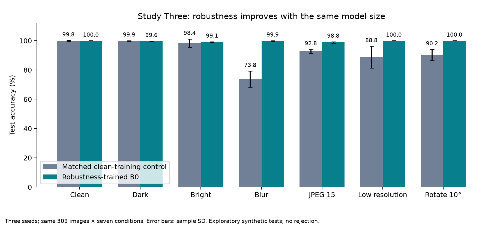

# EfficientNetB0 · 3D-printed object defect classification

IDAT7215 · Group8 · Reproducible experiments, a compact model and matched robustness training.



## Download the complete project

[**Download code, trained model and results (ZIP)**](IDAT7215-EfficientNetB0-complete.zip)

The archive contains the full source tree, the fixed seed42 full model, shared data manifests, three-study results, all per-image prediction evidence, independent verification scripts, report notes and detailed attribution. Original photographs are downloaded from their pinned public sources; they are not redistributed here. The project is packaged as one archive to keep the source and the model/evidence together.

## What improved

StudyThree, mean test accuracy across seeds42/43/44. Both fresh training arms use the same image order, initial weights, 30epochs, batch30 and1110optimizer updates.

| Condition | Clean-training control | Robustness training |
|---|---:|---:|
| Clean |99.78%|**100.00%**|
| Dark |**99.89%**|99.57%|
| Bright |98.38%|**99.14%**|
| Blur |73.79%|**99.89%**|
| JPEG quality15 |92.77%|**98.81%**|
| Downsample to56 |88.78%|**100.00%**|
| Rotate10° |90.18%|**100.00%**|
| Seven-condition mean |91.94%|**99.63%**|

The model still has **4,131,685 parameters**. Inference uses one original view and predicts every image: no rejection, ensemble or test-time augmentation. Adoption was determined using the fixed validation rule before extracting this extension's test features.

These are exploratory synthetic tests on309 known public images. The extension was designed after earlier stress tests had been inspected, and the tested corruption types/strengths also appear in training. Three seeds reuse the same images. These results do not establish performance on new print runs or superiority over a teammate's model under untested corruptions. The dark-image tradeoff is reported above.

## Inspect and independently audit

Python3.12 is the reference environment. No machine-learning installation is required for metric audits.

```sh
git clone https://github.com/AHJ8273528/IDAT7215-EfficientNetB0.git
cd IDAT7215-EfficientNetB0
unzip IDAT7215-EfficientNetB0-complete.zip -d project
cd project
python3 unpack_evidence.py
python3 main.py --verify
python3 robustness_upgrade/verify_robustness.py
```

## Run the supplied model

From the extracted `project` directory:

```sh
python3.12 -m venv .venv
source .venv/bin/activate
python -m pip install -r requirements.txt
python code/predict.py --model robustness_selected_seed42.keras --image YOUR_IMAGE.jpg
```

Input: OpenCV224×224 RGB float32 in[0,255], without external division by255. Output order: normal0, defect1; exact probability ties go to normal. Predictions are image labels, not bounding boxes.

## Reproduce the new training experiment

```sh
python code/prepare_data.py --data work/data
python code/experiment.py --data work/data --cache work/features --stage cache --study three
python robustness_upgrade/run_robustness.py --data work/data --base-cache work/features --cache work/robust_features --output work/robust_reproduced
```

The separate output preserves supplied results. The archive's detailed README documents the original117-fit core experiments and earlier validation extensions. A complete fresh robustness run extracts the frozen features and trains six heads; downloads require internet access.

## Original results retained

| Study | Train / validation / test | Selected B0 accuracy | Defect recall |
|---|---|---:|---:|
| One |189 /27 /55|99.39%|100.00%|
| Two |2111 /308 /598|99.83%|99.49%|
| Three |1089 /159 /309|100.00%|100.00%|

These are three-seed means under the original validation selection rule. StudyOne's existing GAP+norm ablation also reached100%, but was not substituted for its original default after seeing the test scores. The v3 robustness extension concerns StudyThree only. Time-block, similarity-screening and cross-domain results are included to make generalization limitations visible.

## Attribution

Data and paper: [AMdataset](https://github.com/mahsan2/AMdataset), [published study](https://doi.org/10.1016/j.eswa.2024.124293). Shared split and asset inventory: [RachelYim67's group repository](https://github.com/RachelYim67/IDAT7215-3D-Defect-Detection). VGG16 comparison: [dustilayer's repository](https://github.com/dustilayer/IDAT7215-VGG16-Study-One). Third-party prediction evidence is identified and retains its original class order. This project uses TensorFlow/Keras ImageNet architectures and weights.

The work includes AI-assisted code and writing. The student must understand, verify and accurately declare it under course rules. This individual experimental contribution still requires integration into the group's report, named presentation and final submission. See `ATTRIBUTION.txt` inside the archive.

Archive SHA-256: `ba40ddd261b6bceea65edb8f2f0e116cd8d0a9d4f98f24d59506a01704b04d3d`.
